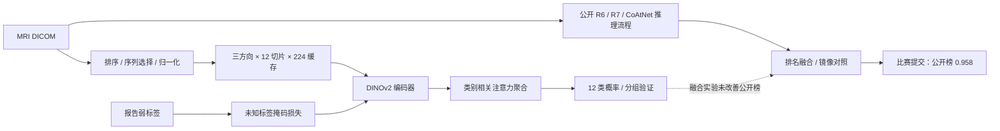

# 膝关节 MRI 多标签异常检测

**Kaggle RSNA Knee Abnormality Detection · 医学影像、弱监督学习与模型集成**

从一次膝关节 MRI 检查预测 12 类异常的概率。本项目整理比赛期间的数据处理、图像模型训练、分组验证、公开方案复现和推理工程，保留成功实验与负结果。

| 成果 | 结果与口径 |
|---|---|
| 最终排名 | **1634 / 6425，前 25.4%**（参赛者反馈） |
| 最佳公开榜 AUC | **0.958**，R6/R7/CoAtNet 集成 |
| 最终私榜 AUC | **0.942**（参赛者反馈，队伍 Open_LM） |
| 数据规模 | 4,407 例检查，24,371 个 MRI 序列 |
| MRI 训练缓存 | 约 4.94 GiB，避免反复解码原始 DICOM |
| DINO 三折平均弱标签 AUC | 冻结编码器 **0.7913 → 四层微调 0.8111** |

## 项目工作与来源

- **数据工程**：DICOM 解码、切片排序、方向分组、强度归一化及缓存；检查缺失方向和重复影像。
- **弱监督训练**：处理仅 58 例有完整官方标签、其余 4,349 例缺标签的训练集；使用公开报告弱标签，未知标签不作为阴性。
- **训练与评估**：实现 DINOv2 图像分支、类别相关注意力聚合和掩码损失；比较冻结、最后两层及四层微调；保存三折折外预测。
- **复现与推理工程**：基于公开 R6/R7/CoAtNet 权重开展排名融合、镜像预测、缓存复用、权重校验和超时回退实验。

R6/R7/CoAtNet 的预训练与比赛权重来自公开作者，**本项目不声称从零训练了这些模型**。DINO 的通用预训练权重同样来自公开模型，本项目训练的是任务分类头及部分编码器层。实现和调试使用了 AI 编程辅助，参赛者执行 Kaggle 实验、反馈结果并完成提交。完整来源见 [THIRD_PARTY.md](THIRD_PARTY.md)。

## 方法



图中的 224 缓存专用于自己的训练分支；公开模型保留各自的输入处理，不能直接共用相同图像张量。报告仅提供训练监督，图像推理不读取报告。

目标：ACL、MCL、Medial Meniscus、Lateral Meniscus、Medial OA、Lateral OA、PF OA、Effusion、Synovitis、Baker's、Contusion、Fracture。

实现细节、融合公式及验证边界见 [方法说明](docs/METHODS.md)。

## 实验结果

| 实验 | 弱标签开发集 AUC | 弱标签保留集 AUC | 公开榜 AUC |
|---|---:|---:|---:|
| 冻结 DINO + 分类头 | 0.7806 | 0.8047 | — |
| DINO 最后两层微调 | 0.7970 | 0.8092 | — |
| DINO 最后四层微调 | 0.8065 | 0.8151 | — |
| 公开 R6/R7/CoAtNet 集成 | — | — | **0.958** |
| 集成 + 单个 DINO，权重 5% | — | — | 0.955 |
| 集成 + 三折 DINO，权重 2% | — | — | 0.957 |

另一次固定训练日程的三折对照覆盖 4,292 例：每折微调均优于冻结头，折平均 AUC 从 0.7913 提高至 0.8111，合并 OOF AUC 从 0.7896 提高至 0.8110。

**结论：弱标签验证改善，没有转化成已有强集成的公开榜收益。** 因此停止增加 DINO 权重，最终推荐保留 0.958 的原始与镜像方案。弱标签指标、58 例官方参考指标和排行榜指标不可直接比较。详见 [实验记录](docs/EXPERIMENTS.md) 与 [聚合结果](results/competition_summary.json)。

## 运行

推荐先在 CPU 上运行合成数据测试；真实训练需要自行获得比赛数据与挂载输出。

```bash
python -m venv .venv
# 激活环境后，先根据机器 CUDA 环境安装匹配的 torch / torchvision
python -m pip install -r requirements.txt
python scripts/check_project.py
```

`scripts/check_project.py` 会检查源文件及 Notebook 语法，并运行无需下载数据或模型的单元测试。它不能验证 GPU 推理速度或重新得到比赛成绩。

Kaggle Notebook、完整 Input 地址与训练顺序见 [复现指南](docs/REPRODUCE.md)。仓库不包含影像、报告、病例级预测、密钥或模型权重。

## 文件结构

```text
src/         DICOM starter、DINO 训练、分组交叉验证、缓存及融合代码
notebooks/   四个清除运行输出的 Kaggle DINO 实验入口
tests/       分组隔离、梯度、掩码损失、融合和缓存测试
results/     聚合指标与本地核查结果，不含病例级报告或标签
docs/        方法、实验、复现步骤、简历与面试说明
scripts/     本地项目检查入口
```

最终公开集成的完整第三方代码与权重通过原作者页面获取，未将压缩嵌入的第三方代码作为本项目源码重新发布。仓库提供其方法、来源和独立融合公式参考实现；该参考实现并非完整隐藏测试推理器。

## 简历引用

> **膝关节 MRI 多标签异常检测｜Kaggle RSNA，1634/6425（前 25.4%）**  
> 构建覆盖 4,407 例 MRI 的 DICOM 预处理与弱监督训练流程，完成 12 类异常检测；复现公开模型集成并开展 DINOv2 部分微调、分组交叉验证及融合对照，最终私榜 AUC **0.942**，公开榜最佳 AUC 0.958。

更多表述和面试问答见 [RESUME.md](docs/RESUME.md)。本项目为竞赛研究实践，没有临床部署或临床有效性验证。
